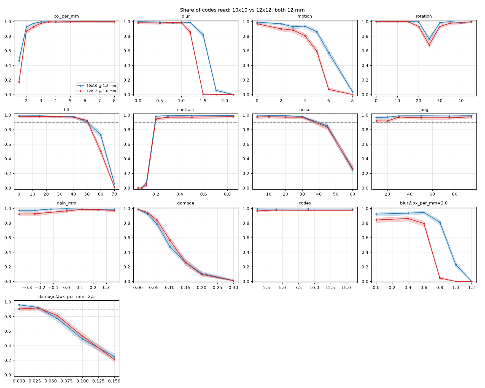

# 0001. Data Matrix 10×10 or 12×12 at the same label size

- **Status:** Draft
- **Date:** 2026-10-22
- **Decision it informs:** [ADR 0001](../adr/0001-label-code-format.md), the
  label code format

## Question

A label's code has a fixed place on the label: 12 mm square. Into it goes
either today's 10×10 Data Matrix with 1.2 mm modules, or a 12×12 symbol with
1.0 mm modules. Both hold the six-digit number. The 12×12 symbol has more
error correction: 7 codewords instead of 5, so it can repair three damaged
codewords instead of two. Its modules are smaller, so it needs a sharper
image.

Which one does a phone read more often, under the conditions a label in a pot
meets?

## Answer

**10×10.** At this size the larger modules matter more than the extra error
correction. 12×12 reads better only when part of the code is covered, and
then only in the middle of the range (6 to 10 % of the data area covered).
Everywhere else it reads as well or worse, and much worse when the image is
small, out of focus or moving.

ADR 0001 stays as it is.

## Method

Everything is synthetic: rendered camera frames, no photos and no collection
data. The code is in [research/datamatrix-size](../../research/datamatrix-size/),
and the experiment is fully described by its
[config.yaml](../../research/datamatrix-size/config.yaml).

**The symbols.** Both come from the server's own encoder; the 12×12 one is
the same encoder with that size's codeword counts. Before any frame is drawn,
500 random numbers and three fixed ones (000001, 004217 and 999999) are
checked in each size: the 10×10 symbol is the server's
module for module, libdmtx encodes the same modules for both sizes, and every
clean symbol decodes back to its number with both zxing-cpp and libdmtx.

**The frames.** A 1280×720 grey frame, the size a phone's camera hands to a
code reader. A 15 mm white label with the 12 mm code lies on a random
background and is projected into the frame: scale (pixels per millimetre),
in-plane rotation, tilt with a central projection, print contrast, defocus,
motion blur, noise and JPEG compression. Ink spread (dot gain) and damage are
applied to the printed label in millimetres: the damage is round blots of 0.5
to 1.5 mm radius, half dark and half light, centred in the smaller of the two
data areas (the 10×10 one, 9.6 mm square), until they cover the given share
of it. The rendering is
adapted from
[libscanner/datamatrix-benchmark](https://github.com/libscanner/datamatrix-benchmark)
(MIT No Attribution).

**Pairs.** Each trial draws one scene from its own seed: where the label lies,
its angle, tilt axis, background, number and blots. That scene is then drawn
twice, once with each symbol, with the same noise. The two frames differ only
in the symbol, so every trial compares the two sizes directly.

**The reader.** zxing-cpp 3.1.1, the phone app's fallback decoder and the
server's reader ([ADR 0004](../adr/0004-technology-stack.md)), with rotation,
inversion and downscaling tried, the local average binarizer, and the image
not assumed to be a pure symbol. A code counts as read when the reader
returns its exact number.

**The points.** A base condition (3 px/mm, about 30 cm from the phone, no
blur, contrast 0.85, light noise) and, from it, one condition changed at a
time over a range. Two combinations: blur at 2 px/mm, and damage at 2.5 px/mm.
Then a mixture: 2000 frames with every condition drawn at random within
moderate ranges. 500 paired frames per point, 46 500 pairs in all.

**Statistics.** The share of codes read, with a Wilson 95 % interval. Whether
one size is better at a point: an exact two-sided sign test on the pairs in
which only one of the two was read. A condition's limit is the hardest value
at which at least 90 % of codes were read.

## Results



Every point with its counts and intervals:
[summary.md](../../research/datamatrix-size/results/summary.md) and
[per_point.csv](../../research/datamatrix-size/results/per_point.csv).

No number was ever read wrong, at any point, with either size.

| condition | 90 % limit, 10×10 | 90 % limit, 12×12 | where they differ most |
| --- | --- | --- | --- |
| scale, px/mm | 2.0 | 2.5 | 1.5 px/mm: 46 % vs 17 % |
| defocus, sigma px | 1.2 | 1.0 | 1.5: 82 % vs 0.4 % |
| defocus at 2 px/mm | 0.6 | none | 0.8: 81 % vs 5 % |
| motion blur, px | 4 | 2 | 6: 57 % vs 7 % |
| rotation, degrees | 20 | 20 | 25: 76 % vs 68 % (the dip, below) |
| tilt, degrees | 50 | 50 | 60: 73 % vs 50 % |
| contrast | 0.2 | 0.2 | 0.2: 98 % vs 95 % |
| noise, sigma | 30 | 30 | none significant |
| JPEG quality | 10 | 10 | 20: 97 % vs 92 % |
| dot gain, mm | ±0.36 | ±0.36 | −0.12: 99 % vs 95 % |
| damage, share of data area | 0.03 | 0.03 | 0.10: 48 % vs 57 % (12×12 better) |
| labels per frame | 16 | 16 | 16: 99 % vs 97.5 % |
| mixture | | | 58 % vs 52 % |

- **Image size and sharpness decide it.** With 1.0 mm modules, 12×12 needs
  about a quarter more pixels per millimetre for the same reading, and loses
  sooner to defocus and motion. At 2 px/mm it never reaches 90 %, even in
  focus.
- **Even in easy conditions 12×12 reads a little less:** 97 to 98 % against
  99 to 100 % for 10×10 at the base condition.
- **Damage is where 12×12 helps.** With 6 % and 10 % of the data area covered
  it reads 84 % and 57 % against 78 % and 48 % (p = 0.013 and 0.003). Both fall
  below 90 % beyond 3 %, and at 2.5 px/mm the advantage is no longer
  significant: the smaller modules use up what the error correction gains.
- **In the mixture** 10×10 read 309 frames that 12×12 missed, and 12×12 read
  181 that 10×10 missed (p < 10⁻⁶).

## Limits of this study

- The frames are rendered, not photographed. They model the main ways a phone
  image degrades, but not glare, uneven light, curved labels or a real
  camera's processing. The comparison between the sizes is the result; the
  absolute shares are not a forecast of reading in a greenhouse.
- One reader, zxing-cpp. ML Kit, the phone app's first reader, was not
  tested: it does not run outside Android. It may weigh module size and error
  correction differently.
- **Open point: a dip at 25°.** Both sizes read less at an in-plane angle of
  25° (76 % and 68 %) than at 20° or 30°, and recover fully by 35°. It hits
  both symbols the same way, so it does not change the comparison. It is
  probably how the reader samples a grid at that angle, but this was not
  investigated. If photographs of real labels show the same dip, it belongs to
  the reader and is worth reporting upstream.

## Reproduce

The results above come from Actions run
[39770105526](https://github.com/Square-Pot/squarepot/actions/runs/39770105526)
of the workflow **Research: Data Matrix size** on commit `85979a9`, with
*smoke* unchecked. Run artifacts expire; the run can be repeated exactly.

- **In GitHub Actions:** Actions, *Research: Data Matrix size*, Run workflow,
  *smoke* unchecked, on a branch where `research/datamatrix-size/` and
  `.github/workflows/research-datamatrix.yml` are as in `85979a9`. Six shards
  draw the frames in parallel; the `results` artifact holds `results/`, the
  `raw-0` … `raw-5` artifacts hold every frame's outcome.
- **Elsewhere:** Python 3.12, libdmtx, and the pinned packages:

  ```sh
  cd research/datamatrix-size
  pip install -r requirements.txt
  python run.py all
  ```

Every random choice comes from the seed `20261021` in `config.yaml`: trial *n*
draws its scene from `SeedSequence([20261021, n])`, so the same code and
package versions give the same frames, the same read counts and the same
`summary.md`. Only the decoding times (`median_ms`) change from run to run. A
second run,
[39771999047](https://github.com/Square-Pot/squarepot/actions/runs/39771999047)
on `1b0fa26`, where the research code, the workflow and the server's encoder
are the same as in `85979a9`, gave identical counts and an identical `summary.md`.
